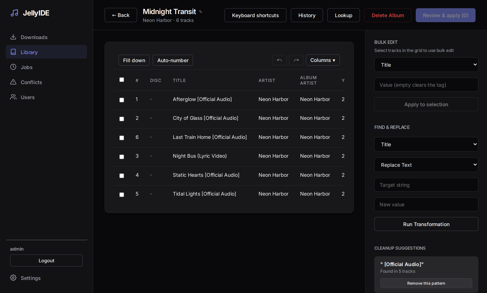
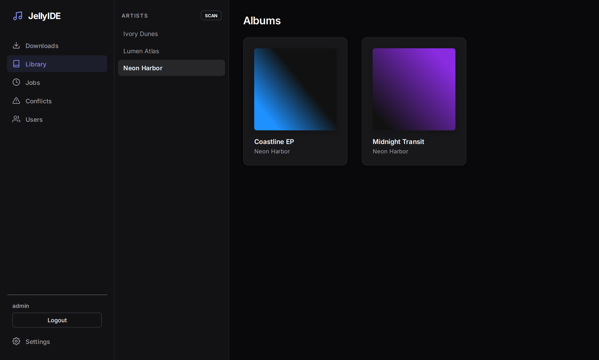
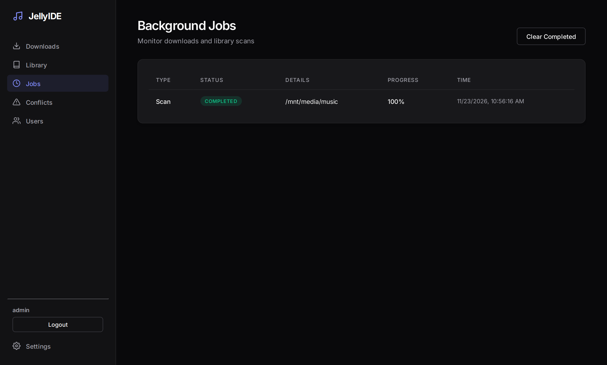
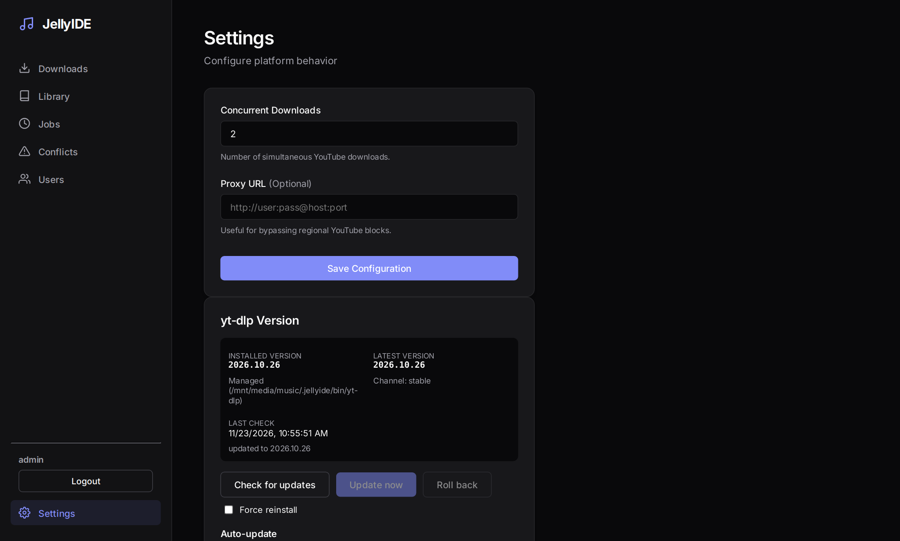
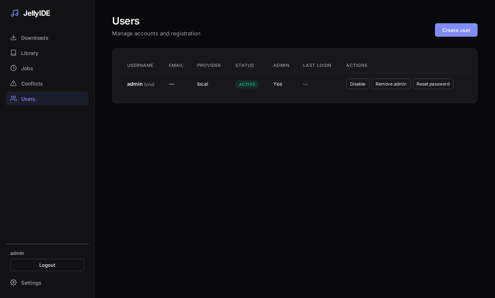
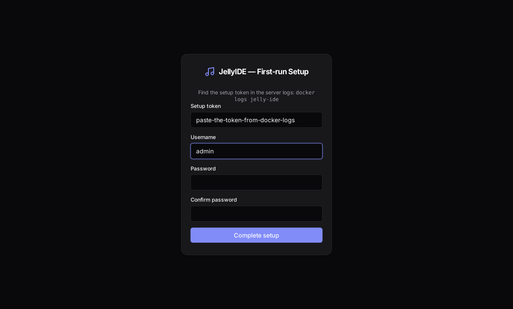
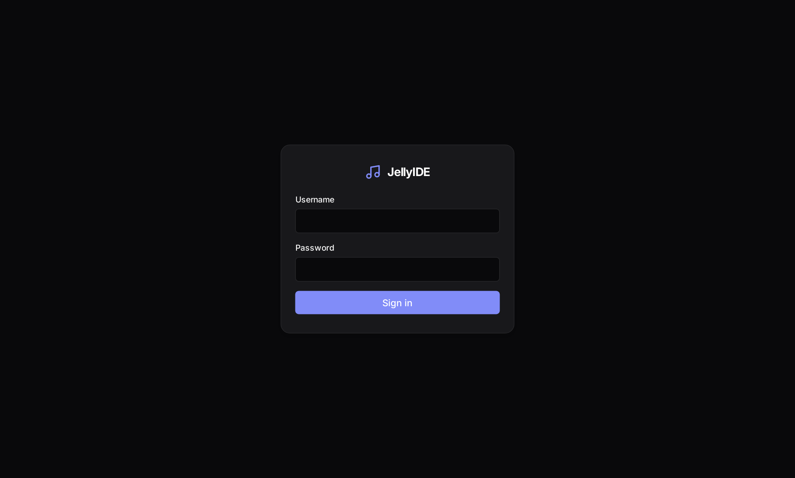
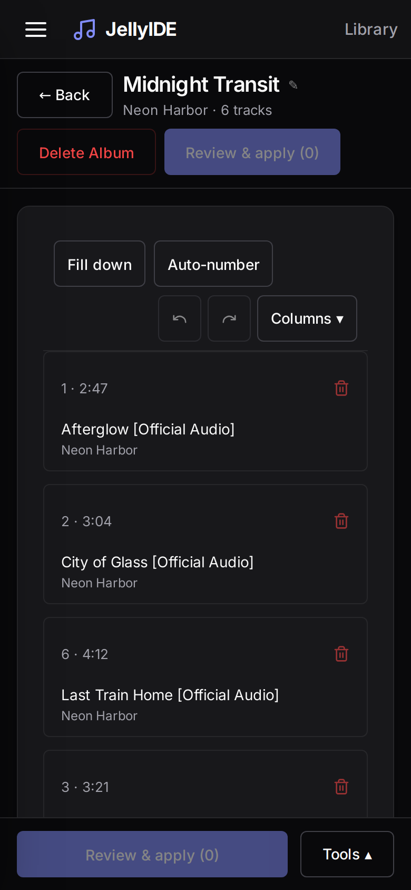
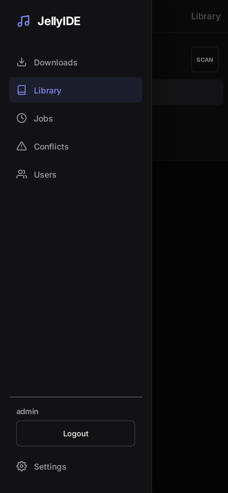
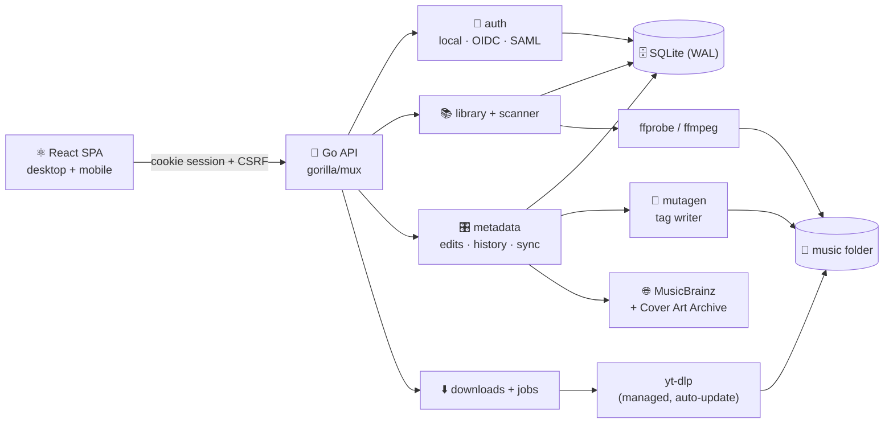

<div align="center">


<br>

**The self-hosted IDE for your music library.**<br>
Download from YouTube, tag like a pro, and keep a perfectly organized collection for Jellyfin, Navidrome or Plex.

<br>

[](https://github.com/Tae5609/jellyide/actions/workflows/ci.yml)
[](https://github.com/Tae5609/jellyide/releases/latest)
[](LICENSE)
<br>


[**Features**](#-features) · [**Screenshots**](#-screenshots) · [**Quick start**](#-quick-start) · [**Docs**](#-documentation) · [**License**](#-license)

<br>



</div>

<br>

## ✨ Features

<table>
<tr>
<td width="50%" valign="top">

### ⬇️ Downloads
- Queue **YouTube videos and whole playlists**, extracted to FLAC by `yt-dlp`
- Thumbnail and metadata embedded automatically
- Concurrent downloads, optional proxy for region-locked content
- **Retry** failed jobs with one click, with automatic retry and backoff for flaky networks
- **Managed yt-dlp**: admins check, update and roll back from the UI, with optional auto-update

</td>
<td width="50%" valign="top">

### 📚 Library
- Persistent **SQLite** index of artists, albums and tracks
- Background scanner powered by `ffprobe`
- Cover art picked up from the folder **or from the artwork embedded in the files**
- Browse artist → album → tracks, stream audio in the browser
- Album rename moves the folder and rewrites the tags

</td>
</tr>
<tr>
<td width="50%" valign="top">

### 🎛️ Metadata IDE
- Spreadsheet-style **track grid** with undo/redo, bulk edit, fill-down and auto-numbering
- Every field: title, artist, album artist, track/disc, year, genre, composer, comment
- Tags written into the real files (FLAC, MP3, Ogg, M4A)
- **Smart cleanup** finds noise like `[Official Audio]` across an album
- **MusicBrainz lookup** with confidence scores, plus cover art from Cover Art Archive
- Full **history with revert**, and **keyboard shortcuts** for everything

</td>
<td width="50%" valign="top">

### 🔄 Sync safety
- Renames **never overwrite** an existing file
- Detects conflicts between the database, file tags and other users
- **You choose** per field: JellyIDE value, file value, or a custom value
- Policies: `ask` (default), `file_wins`, `db_wins`
- Relink moved files without losing history, and restore replaced files from the trash

</td>
</tr>
<tr>
<td width="50%" valign="top">

### 🔐 Users & SSO
- Local accounts, **OIDC** (PKCE) and **SAML 2.0** single sign-on
- First-run **setup wizard**, with no default passwords
- Registration modes: admin-only, open, or with approval
- Admin Users page, an audit log, and a recovery CLI
- Hashed session cookies, CSRF protection and rate limiting

</td>
<td width="50%" valign="top">

### 📱 Everywhere
- Responsive down to **360 px**: drawer menu, card layouts, bottom sheets
- One Docker image with everything bundled (ffmpeg, yt-dlp, mutagen)
- One SQLite file next to your music, so it survives a rebuild
- Jobs dashboard for downloads, scans, tag writes and updates

</td>
</tr>
</table>

## 📸 Screenshots

<table>
<tr>
<td width="50%"><p align="center"><sub><b>Library</b>: artists, albums and covers</sub></p></td>
<td width="50%"><p align="center"><sub><b>Jobs</b>: every background task, with retry</sub></p></td>
</tr>
<tr>
<td width="50%"><p align="center"><sub><b>Settings</b>: managed yt-dlp and sync policy</sub></p></td>
<td width="50%"><p align="center"><sub><b>Users</b>: roles, approval, password reset</sub></p></td>
</tr>
<tr>
<td width="50%"><p align="center"><sub><b>First run</b>: create the admin with a setup token</sub></p></td>
<td width="50%"><p align="center"><sub><b>Login</b>: local accounts or SSO</sub></p></td>
</tr>
</table>

<div align="center">

&nbsp;&nbsp;

<p><sub><b>On your phone</b>: the same editor, as cards and bottom sheets</sub></p>
</div>

<p align="center"><sub>Screenshots use a generated demo library with fictional artists.</sub></p>

## 🚀 Quick start

> **Requirements:** Docker with Compose v2.

### Option A: prebuilt image (recommended)

```bash
# .env, next to docker-compose.prod.yml
IMAGE=ghcr.io/tae5609/jellyide:latest
MUSIC_DIR=/mnt/media/music
```

```bash
docker compose -f docker-compose.prod.yml up -d
docker logs jelly-ide          # copy the one-time setup token
```

### Option B: build from source

```bash
git clone https://github.com/Tae5609/jellyide && cd jellyide
export MUSIC_DIR=/mnt/media/music
docker compose up -d --build
docker logs jelly-ide          # copy the one-time setup token
```

Then open **http://localhost:8080/setup**, paste the token, create your admin account, and press **Scan** on the Library page. 🎉

<details>
<summary><b>Running behind HTTPS / a reverse proxy</b></summary>

Set `PUBLIC_URL=https://music.example.com` and `COOKIE_SECURE=true`. Caddy and nginx examples, the full environment-variable table, backups and upgrades are in [docs/DEPLOYMENT.md](docs/DEPLOYMENT.md). OIDC and SAML setup (including a ready-made Keycloak dev stack) is in [docs/AUTHENTICATION.md](docs/AUTHENTICATION.md).
</details>

<details>
<summary><b>Unattended install (no setup wizard)</b></summary>

Set `ADMIN_PASSWORD` (and optionally `ADMIN_USERNAME`, default `admin`) before the first start. It is only used while no users exist, and is never re-applied.
</details>

<details>
<summary><b>Forgot the admin password?</b></summary>

The server binary includes a recovery CLI that works while JellyIDE is running:

```bash
docker exec -it jelly-ide ./server admin reset-password admin             # prompts, no echo
docker exec -it jelly-ide ./server admin reset-password admin --generate  # prints a random password once
docker exec -it jelly-ide ./server admin list
docker exec -it jelly-ide ./server admin create alice --admin
docker exec -it jelly-ide ./server admin promote|demote|enable|disable <user>
docker exec -it jelly-ide ./server admin unlock                           # clear the login rate limit
```

A reset signs the user out everywhere. The last active admin can't be demoted or disabled, and every action is written to the audit log.
</details>

<details>
<summary><b>Upgrading from v1.x</b></summary>

Login is required since v2.0.0. On the first start after upgrading, JellyIDE enters setup mode: run `docker logs jelly-ide`, then open `/setup`. Run a Library scan once afterwards to fill the new tag fields and pick up embedded covers. See the [v2.0.0 release notes](https://github.com/Tae5609/jellyide/releases/tag/v2.0.0).
</details>

## ⌨️ Keyboard shortcuts

| Keys | Action | | Keys | Action |
|---|---|---|---|---|
| <kbd>Ctrl</kbd>+<kbd>S</kbd> | Review & apply | | <kbd>L</kbd> | MusicBrainz lookup |
| <kbd>Ctrl</kbd>+<kbd>Z</kbd> / <kbd>Ctrl</kbd>+<kbd>Shift</kbd>+<kbd>Z</kbd> | Undo / redo | | <kbd>H</kbd> | History |
| <kbd>↑</kbd> <kbd>↓</kbd> <kbd>←</kbd> <kbd>→</kbd> · <kbd>Enter</kbd> | Move · edit cell | | <kbd>/</kbd> | Find & replace |
| <kbd>Ctrl</kbd>+<kbd>D</kbd> | Fill down | | <kbd>?</kbd> | All shortcuts |
| <kbd>g</kbd> then <kbd>d</kbd> <kbd>l</kbd> <kbd>j</kbd> <kbd>s</kbd> | Go to Downloads / Library / Jobs / Settings | | <kbd>Esc</kbd> | Cancel / close |

Full list in [docs/METADATA.md](docs/METADATA.md).

## 🧱 How it works



More detail, including the data model, request lifecycle and design decisions, is in [docs/ARCHITECTURE.md](docs/ARCHITECTURE.md).

## 📖 Documentation

| | Document | What's inside |
|---|---|---|
| 🏗️ | [Architecture](docs/ARCHITECTURE.md) | components, data model, job system, design decisions |
| 🚢 | [Deployment](docs/DEPLOYMENT.md) | compose files, every env var, reverse proxy, backups, troubleshooting |
| 🔐 | [Authentication](docs/AUTHENTICATION.md) | setup wizard, accounts, registration modes, OIDC and SAML, security model |
| 🎛️ | [Metadata guide](docs/METADATA.md) | the editor, lookup, history, sync conflicts, all shortcuts |
| 🔌 | [API reference](docs/API.md) | every endpoint, with auth, request, response and errors |
| 🛠️ | [Development](docs/DEVELOPMENT.md) | local setup, Makefile, quality gates, tests, project layout |
| 🤝 | [Contributing](CONTRIBUTING.md) | commit and PR conventions |

## 🧰 Tech stack

| Layer | Built with |
|---|---|
| **Backend** | Go 1.25 · gorilla/mux · sqlx + pure-Go SQLite · bcrypt · go-oidc · crewjam/saml |
| **Frontend** | React 18 · react-router 7 · hand-crafted dark CSS (no UI framework) |
| **Media** | yt-dlp · ffmpeg / ffprobe · Python 3 + mutagen |
| **Quality** | golangci-lint · `go test -race` · ruff · ESLint · Prettier · Jest + Testing Library (74% coverage) · end-to-end auth smoke test |
| **Delivery** | a single Alpine Docker image on GHCR · Docker Compose · GitHub Actions |

## 🛠️ Development

```bash
make check      # lint + test + build, backend and frontend
make fmt        # gofmt/goimports, ruff, prettier
```

Prerequisites, running locally and the test layout are in [docs/DEVELOPMENT.md](docs/DEVELOPMENT.md). Commits follow [Conventional Commits](https://www.conventionalcommits.org/) (`feat(metadata): …`), and every PR goes through CI. See [CONTRIBUTING.md](CONTRIBUTING.md).

## 📄 License

JellyIDE is **source-available** under the [**PolyForm Noncommercial License 1.0.0**](LICENSE).

- ✅ **Free** for personal use, hobby projects, study, research, and non-profit, educational or government organizations.
- ✅ You may modify it and share it, under the same terms.
- ❌ **Commercial use is not permitted** without a separate license. If you want to use JellyIDE commercially, [open an issue](https://github.com/Tae5609/jellyide/issues) to ask.

JellyIDE runs third-party tools as separate programs, under their own licenses: [yt-dlp](https://github.com/yt-dlp/yt-dlp) (Unlicense), [FFmpeg](https://ffmpeg.org/legal.html) (LGPL/GPL), [mutagen](https://github.com/quodlibet/mutagen) (GPL-2.0). Metadata lookups use [MusicBrainz](https://musicbrainz.org/) and the [Cover Art Archive](https://coverartarchive.org/). Please respect the terms of the content you download.

<div align="center">
<br>

<br>
<sub>Made with 🎵 by <a href="https://github.com/Tae5609">Tae5609</a></sub>
</div>
