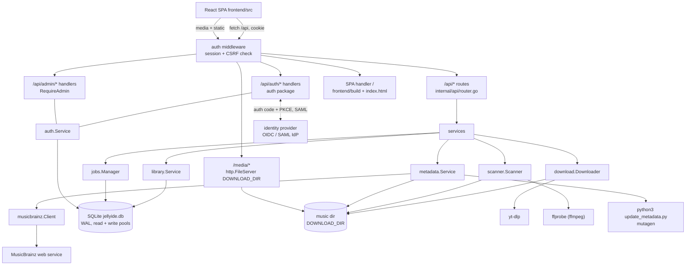
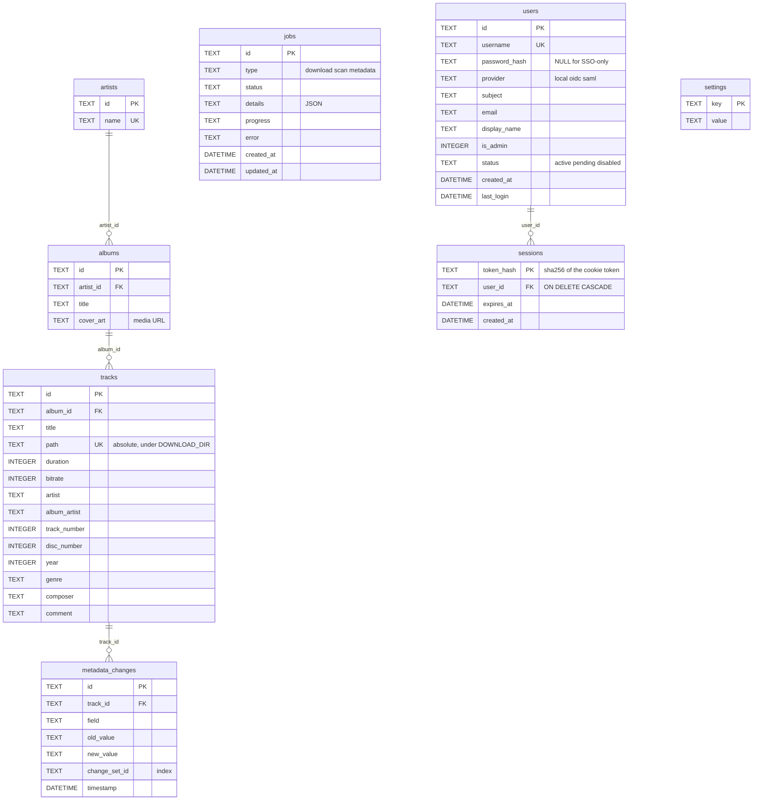

# JellyIDE architecture

One Go process serves the JSON API, the media files and the single-page frontend. This file
describes the components, the data model, the request lifecycle and the job system, taken
from the code in `backend/` and `frontend/src/`. The endpoint-by-endpoint contract lives in
[API.md](API.md); how to build and test is in [DEVELOPMENT.md](DEVELOPMENT.md).

## Table of contents

- [Overview and component diagram](#overview-and-component-diagram)
- [Request lifecycle](#request-lifecycle)
- [Packages](#packages)
- [Data model](#data-model)
- [Job system](#job-system)
- [External tools](#external-tools)
- [Key design decisions and trade-offs](#key-design-decisions-and-trade-offs)

## Overview and component diagram

The React SPA (built with react-scripts into `frontend/build`) talks to the Go server over
same-origin `fetch`. The server wraps everything in the auth middleware, then dispatches on a
`gorilla/mux` router: `/api/auth/*`, `/api/admin/*` and the route table in
`backend/internal/api/router.go` under the `/api` prefix, `/media/*` as a file server over the
music directory, and `/` as the SPA fallback handler.



The SPA is same-origin, so there is no CORS handling (the old `AllowedOrigins: *` middleware
was removed; see `docs/plan/BUGS.md`).

## Request lifecycle

`main.go` builds one `mux.Router`, mounts the subrouters and wraps the whole thing:

```go
handler := authSvc.Middleware(r)   // backend/main.go
```

For every request, `Service.Middleware` (`backend/internal/auth/middleware.go`):

1. If `AUTH_ENABLED=false` (`auth.Config.Enabled`) → pass through; the anonymous superuser
   applies (see `/api/auth/me`).
2. Else classify the path with `isPublicPath`: everything outside `/api/` and `/media/`, plus
   `/api/auth/*` except `/api/auth/me`, `/api/auth/logout` and `/api/auth/password`, is
   public → pass through.
3. Protected paths (`/api/*` and `/media/*`): resolve the `jellyide_session` cookie via
   `Service.UserFromRequest` (sha256 hash lookup, expiry + sliding renewal, active-status
   check). Failure → `401 {"error":"unauthorized"}`.
4. On `POST`/`PUT`/`PATCH`/`DELETE`, require the header `X-Requested-With: XMLHttpRequest`
   (CSRF guard) → missing or wrong → `403 {"error":"csrf"}`.
5. Store the user in the request context (`userContextKey{}`), continue to the matched
   handler. Handlers read it back with `UserFromContext`.

The admin subrouter additionally runs `RequireAdmin` (`admin.go`): `is_admin` must be set,
else `403 {"error":"admin required"}`.

The router itself (`api.RegisterRoutes`) is a flat table — method + path pattern + handler
closure over one of the five injected services. Handlers decode JSON with
`json.NewDecoder(r.Body)`, answer through `writeJSON` / `sendJSONError`, and map the
metadata package's typed errors (`ValidationError`, `NotFoundError`, `ConflictError`) to
`400` / `404` / `409` in `writeMetadataError`.

Sessions: opaque 32-byte crypto/rand tokens, base64url in the `HttpOnly; SameSite=Lax`
cookie (`Secure` when `COOKIE_SECURE=true`), only the sha256 hex digest in the `sessions`
table, 7-day TTL, slid forward when under 6 days remain, purged hourly
(`startSessionCleanup`). Logout deletes the row and clears the cookie (`MaxAge=-1`).

## Packages

| Package | Responsibility (from the code) |
|---|---|
| `backend/main.go` | Entry point: loads env (`getEnv`), opens the DB, bootstraps auth (`auth.NewService` — creates the admin when `users` is empty and `ADMIN_PASSWORD` is set), enables OIDC/SAML before route registration, wires services, mounts `/api`, `/media/` and the SPA fallback, serves `:PORT` (8080) with a 10 s read-header timeout |
| `internal/api` | Route table + handlers for download, jobs, config, library, metadata, cover and lookup endpoints; JSON helpers; typed-error → status mapping |
| `internal/auth` | `Config`/env loading, `Service`, local login + bcrypt (`password.go`), registration modes and users/sessions store (`store.go`), login rate limiter and auth handlers (`handlers.go`), middleware + `RequireAdmin` (`middleware.go`), session cookie lifecycle (`session.go`), admin user management + settings (`admin.go`), OIDC authorization-code flow with PKCE/state/nonce (`oidc.go`), SAML 2.0 service provider (`saml.go`), password hashing (`password.go`) |
| `internal/db` | SQLite open with split pools (`DB` embeds the read pool; `Exec`/`NamedExec`/`Beginx` route to a single write connection), per-connection pragmas, `migrate()` (create tables, guarded `ALTER TABLE` for `users.status`, the flexible track tag columns and `metadata_changes.change_set_id`) |
| `internal/download` | `Details` payload, yt-dlp command builder, dispatcher goroutine with a 5000-slot queue channel, concurrency limit + proxy (in-memory, runtime), crash recovery re-queues `queued`/`downloading` jobs at startup |
| `internal/scanner` | Walks `DOWNLOAD_DIR`, probes `.flac`/`.mp3`/`.m4a`/`.aac` with ffprobe, parses Vorbis/ID3 tag fields, `EnsureArtist`/`EnsureAlbum`/`UpsertTrack`, cover detection (`cover.jpg`, `folder.jpg`, …) |
| `internal/library` | Artist/album/track model (`Artist`, `Album`, `Track`), queries and mutations, `RenameAlbum` (directory rename + tag rewrite + DB sync), deletes, `SaveCoverArt`/`CoverFilePath` (media-URL ↔ music-dir path mapping with traversal checks) |
| `internal/metadata` | Title-pattern analyzer (`findSignificantPatterns`), find/replace preview (`PreviewChanges`), the job-backed apply path (`ApplyTrackEdits`, `runApplyJob`, `applyEditsToTrack`), history + revert (`history.go`), cover policy (`cover.go`: validation, allowlist, embed/extract jobs), MusicBrainz lookup mapping (`lookup.go`), tag writer interface (`tags.go`, production: `pythonTagWriter`) |
| `internal/musicbrainz` | HTTP client for the MusicBrainz web service: shared token-bucket rate limiter (1 req/s), 10 s timeout, bounded 10-minute response cache (256 entries), release search + track mapping (exact number match, then Levenshtein title similarity) |
| `backend/update_metadata.py` | Tag writer/reader on the audio files (FLAC/MP3/Ogg/M4A via mutagen): `--title/--album`, `--fields-json`, `--cover`, `--extract-cover` (exit code 2 = no embedded cover); always called with `--` before the file path |
| `frontend/src` | React SPA: `api.js` (`apiFetch` — prefixes `/api`, sends the CSRF header + session cookie, `auth:unauthorized` event on `401`), pages (`Downloads`, `Library`, `Metadata`, `Jobs`, `Settings`, `Login`, `Register`, `Users`), `auth/AuthContext.js`, `components/ModalContext.js` |

## Data model

The schema is what `migrate()` in `backend/internal/db/db.go` creates (plus the guarded
`ALTER TABLE` migrations for databases created before T8/T10). All ids are UUID strings.



Notes from the migration code:

- Uniqueness: `artists.name`; `albums(artist_id, title)`; `tracks.path`; `users.username`;
  `users(provider, subject)`.
- Pragmas on every connection: `busy_timeout=5000`, `journal_mode=WAL`,
  `synchronous=NORMAL`, `foreign_keys=ON`, `wal_autocheckpoint=1000`.
- Indexes: `idx_sessions_user`, `idx_metadata_changes_change_set`.
- The `metadata_changes.track_id` foreign key has no `ON DELETE` clause while
  `foreign_keys=ON`: deleting a track that has change history fails (logged in
  `docs/plan/BUGS.md`, T12 queue).
- `settings` holds the runtime `registration_mode` (`admin_only` | `open` | `approval`); the
  environment variable `REGISTRATION_MODE` seeds it once, the database value wins afterwards
  (`seedRegistrationMode`, `SetRegistrationMode`).

## Job system

`jobs.Manager` (`backend/internal/jobs/manager.go`) is the queue and status store; every
long-running operation becomes a row in `jobs` and a goroutine.

| type | produced by | status flow | details |
|---|---|---|---|
| `download` | `POST /api/queue` | `queued` → `downloading` → `completed`/`failed` | the `download.Details` JSON |
| `scan` | `POST /api/library/scan` | `queued` → `running` → `completed`/`failed` | `{"path": …}`, progress `N tracks found` every 10 files |
| `metadata` | bulk edits, revert, cover upload/from-url | `queued` → `running` → `completed`/`failed` | `action`: `apply_edits` (`change_set_id`, `edits`), `revert_change_set` (`reverts`), `embed_cover` (`album`, `cover`); progress `i/n` |

Key properties from the code:

- The dispatcher is a single goroutine consuming a buffered channel (5000); it gates
  `activeDownloads` against the in-memory `concurrentLimit` (default 2, runtime-changeable
  via `POST /api/config`) with a `sync.Cond`.
- Crash recovery: `NewDownloader` re-reads the table and re-queues every `download` job in
  `queued` or `downloading` state (`0%` progress) at startup.
- Status writes never abort the pipeline; a failed `UpdateJobStatus` is only logged.
- After a successful download the file is indexed immediately (`Scanner.IndexFile`).
- `POST /api/jobs/clear` deletes rows in `completed` or `failed` (`ClearCompleted`).
- Metadata jobs run detached: the endpoint answers `202` with the `job_id` and the shared
  `change_set_id`; the client polls `GET /api/jobs` and refreshes on `completed`.

## External tools

| Tool | Where | Command shape (from the code) |
|---|---|---|
| `yt-dlp` | info fetch | `--dump-single-json --flat-playlist --playlist-end 200 -- <url>` (`infoArgs`; the URL is always after `--`) |
| `yt-dlp` | download | fixed URL argument `https://youtube.com/watch?v=<id>` plus named options (`--extract-audio`, `--audio-format flac`, `--embed-thumbnail`, `--embed-metadata`, `--parse-metadata`, `--replace-in-metadata`, `--js-runtimes node`, `--output`, `--newline`, optional `--proxy`); no user value is ever an option |
| `ffprobe` | scan | `ffprobe -v quiet -print_format json -show_format <file>` |
| `python3 update_metadata.py` | tag writes, rename, cover embed/extract | `python3 update_metadata.py …args… -- <path>` (argument vector, never a shell; exit 2 = no embedded cover) |
| MusicBrainz web service | lookup | `GET <base>/release?...&fmt=json` with `User-Agent: JellyIDE/1.0 …` |

The production image installs `ffmpeg`, `python3`, `nodejs` and `pip3 install yt-dlp mutagen`
(see `Dockerfile`).

## Key design decisions and trade-offs

- **SQLite, split read/write pools.** One process, zero external database service. WAL +
  `busy_timeout=5000` + `synchronous=NORMAL` give concurrent readers (pool of 4) without
  blocking the single writer (pool of 1); `DB.Exec`/`Beginx` intercept and route every write
  to the write connection so call sites never have to care. Trade-off: one writer only —
  heavy scan+apply work serialises, which is exactly what SQLite prefers, but horizontal
  scaling would need a real database.
- **Sessions in the database, not JWTs.** Logout, "disable user" and "admin resets the
  password" must invalidate instantly; server-side rows (`sessions`, deleted on logout, on
  disable, on reset and on delete) give that. The cookie is `HttpOnly; SameSite=Lax`, only a
  sha256 hash is stored, and the state-changing CSRF check complements it. Trade-off: a
  database hit per protected request and no stateless scale-out — acceptable for a
  single-instance self-hosted tool.
- **Python helper for tag writing.** mutagen covers the FLAC/MP3/Ogg/M4A formats reliably;
  writing a full tag writer in Go would duplicate that. The subprocess is always an argument
  vector with `--` before the path (no shell, no option injection), and failures are per-file
  so one bad file does not abort a bulk apply. Trade-off: `python3` + `mutagen` are hard
  runtime dependencies and each write forks a process.
- **Server-rendered SPA fallback instead of a separate web server.** One process, one port,
  same-origin → no CORS and one cookie. The handler serves `index.html` for unknown paths,
  refuses `..` traversal and keeps the static file server for the build output. Trade-off
  (open item in `docs/plan/BUGS.md`): a missing file-extension asset also gets
  `index.html` rather than `404`.
- **Pending edits on the client, applied as one change set.** The metadata UI accumulates
  edits and reviews them before `PATCH /api/metadata/tracks`; the server validates the whole
  batch first (fail fast → `400` with `field`/`track_id`), then applies under one
  `change_set_id` so history and revert work per change set. Trade-off: an applied job that
  renames a file before its database update fails can leave the rename rolled forward
  (accepted parity gap, documented in `apply.go`; re-running or re-scanning repairs).
- **Last-admin check invariant.** The server refuses to demote, disable or delete the last
  active admin (checked before the self-delete rule), so the instance can never become
  unmanageable. The check is check-then-act, not transactional (logged in `BUGS.md`, T12).
- **Rate limiting where users (and servers) need it.** Per IP: 10 failed logins/registers per
  15 minutes → `429` (in-memory, `RemoteAddr`-keyed — shared buckets behind a proxy are a
  known limitation). Outbound to MusicBrainz: one shared token bucket (1 req/s) + 10-minute
  cache to respect the public service.
- **File naming scheme.** Downloads and renames build file names from the sanitized
  title (`/ \ : * ? " < > |` → `-`) plus the original extension; albums map to
  `<DOWNLOAD_DIR>/<artist>/<album>/` with the same sanitizer.
- **Allowlist for outbound cover fetches.** Only `https` and `coverartarchive.org`,
  `archive.org`, `*.archive.org`, re-checked on every redirect (max 3), 15 s timeout,
  10 MiB size cap, `jpeg`/`png` sniffing, ≤4000 px — so a lookup can not turn the server
  into an arbitrary fetcher. The download URL allowlist for the MusicBrainz cover mirror is
  built into the lookup response (`https://coverartarchive.org/release/<mbid>/front`).
- **Timing-safe credential comparison.** Login runs a bcrypt comparison against a dummy hash
  for unknown users, so a wrong username and a wrong password answer in the same time and
  with the same `401 invalid credentials`; the account status (pending/disabled) is only
  revealed after a correct password.
